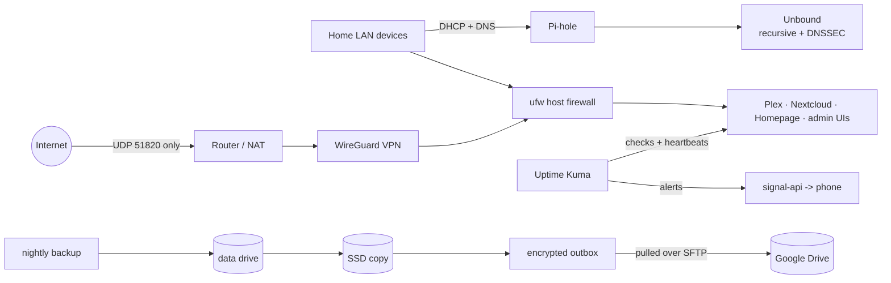

# Homelab: running a home server like production

**JARVIS** is a single-node home server on repurposed hardware: an old laptop running Ubuntu Server and 13 Docker containers for media streaming, file sync, network-wide DNS/DHCP with ad blocking, a WireGuard VPN and monitoring that alerts my phone through Signal.

The apps are the easy part. This repo is about **how it is operated**: one port open to the internet, every change planned with a rollback and logged, backups verified, encrypted off-site and restore-tested, monitoring that also checks that scheduled jobs *did* run, and scripts kept in Git with CI.

> This is the public edition of my private operations repo. It is generated by an export script that copies only approved files, removes addresses and household details, and refuses to export if a leak check finds anything private. The change log with addresses and the live configuration stay private.

## At a glance

| | |
|---|---|
| Hardware | 2010 MacBook Pro (Core 2 Duo, 5 GB RAM, SSD) + 5 TB USB data drive; the laptop battery is the server's UPS |
| OS / platform | Ubuntu Server 26.04 LTS (UTC), Docker, stacks as Compose files in Portainer |
| Internet exposure | One UDP port (WireGuard). Everything else is LAN- or VPN-only |
| Monitoring | 11 Uptime Kuma monitors (HTTP checks + heartbeats for scheduled jobs), alerts to Signal |
| Backups | Nightly, verified, 3-2-1: data drive + internal SSD + encrypted Google Drive copy; restore-tested |
| Change control | What / why / verification / rollback for every change; scripts in Git; CI runs ShellCheck and a secret scan |

## Services

| Service | Purpose |
|---|---|
| Pi-hole + Unbound | DHCP server and DNS for the whole network: ad/tracker blocking, recursive resolving with DNSSEC validation |
| wg-easy (WireGuard) | Remote access; the only service reachable from the internet. Guest peers are limited to specific services |
| Plex | Media streaming (LAN and VPN only, media mounted read-only) |
| Nextcloud | File sync |
| Uptime Kuma + signal-cli | Monitoring with alerts to Signal |
| Homepage | Dashboard; reads Docker only through a socket proxy that allows one API call |
| Portainer, Watchtower, DuckDNS | Stack management, tiered image updates, dynamic DNS |

## Architecture

Details, design decisions and trade-offs: [docs/architecture.md](docs/architecture.md).

## Case studies

Real incidents and changes, written up as context, root cause, fix and what changed afterwards: [docs/case-studies.md](docs/case-studies.md)

1. **DNS went down while switching DHCP to Pi-hole**: a missing container capability, a misleading test device, and the rollback that limited it to 10 minutes.
2. **Monitoring was green while DNS was broken**: why cached answers hid a dead upstream, and how pinning plus a new "uncached lookup" check closed the gap.
3. **Hardening Plex after a public exploit chain**: patch check, hunt for signs of compromise, attack surface removed, and the monitoring alert my own firewall change caused.
4. **3-2-1 backups without giving the server cloud credentials**: public-key encryption, a pull model and a locked-down SFTP account, plus a restore test that failed first.
5. **A major-version upgrade with a dry run**: Uptime Kuma v1 to v2, rehearsed on a copy of the database with networking disabled.
6. **Measure before buying**: a week of ping data on the Wi-Fi backhaul and a VPN load test, used to decide where the real bottleneck is.
7. **A DNSSEC false positive**: a one-day spike of failed lookups traced to my own resolver rejecting an unsigned streaming-service chain, proven against three public resolvers, with a zero-risk fix held back on purpose.

## Scripts

Version-controlled copies of the server's tooling, see [scripts/README.md](scripts/README.md): nightly backup with coverage check and checksums, the 3-2-1 mirror, weekly maintenance, a 10-second health check (`jarvis-status`, ~38 checks), a read-only security audit, DNS/DHCP watchdogs that feed heartbeat monitors, an hourly DNS/ad-blocking/DHCP statistics collector, and the Windows side of the off-site pull.

## Operations practices

- **Change management.** Every change is written down before it runs: what, why, how it will be verified, how to roll it back. Docker stack edits start from the live YAML. Backups are taken before risky changes; artifacts are verified, not success messages.
- **Least privilege.** The account used for AI-assisted operations can run exactly one privileged command, a read-only audit, and cannot touch Docker. A human runs every change from reviewed commands.
- **Monitoring that catches silent failures.** Heartbeat monitors fire when a scheduled job (backup, weekly update, off-site copy, DHCP/DNS/storage watchdogs) did *not* report in. Alerts are proven end to end.
- **Tiered updates.** Daily unattended security updates, a weekly logged full upgrade, auto-updates for low-risk containers, planned changes (backup, verify, rollback) for high-impact ones. Major versions are pinned.
- **Documented risk.** Risks that are knowingly accepted are recorded with the reason and a trigger to revisit them.

## Roadmap

- Image CVE scanning (Trivy) and a host hardening baseline (Lynis)
- Configuration as code (Ansible), reverse proxy with SSO, metrics (Prometheus/Grafana)
- Migration to stronger hardware (Nextcloud on PostgreSQL) with a written disaster-recovery runbook
- UPS for the network gear; wired backhaul

---

Maintained by **Robert Maddux**.
