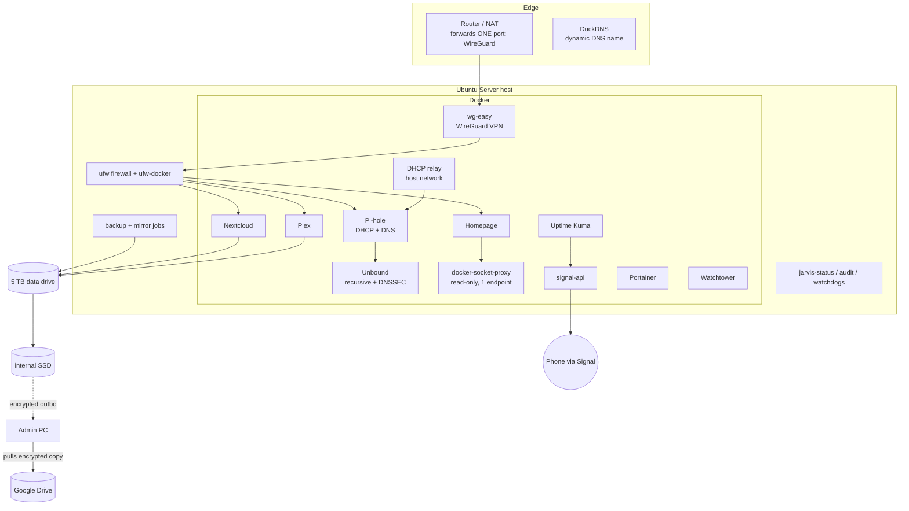

# JARVIS: architecture, design decisions and walk-throughs

Public edition: no addresses, hostnames or secrets. Incidents behind many of these decisions are written up in [case-studies.md](case-studies.md).

## The 30-second pitch

> "I run a single-node home server on repurposed hardware: an old laptop running Ubuntu Server and 13 Docker containers: media streaming, file sync, DHCP and DNS for the whole network with ad blocking, a WireGuard VPN, and monitoring that alerts my phone through Signal. The interesting part isn't the apps, it's how it's operated: one port open to the internet, every change logged with a rollback in Git with CI, encrypted 3-2-1 backups that are restore-tested, updates tiered by risk, and monitoring that also alerts when a scheduled job silently didn't run."

## The stack, layer by layer

### 1. Hardware and OS
- **What:** 2010 MacBook Pro (2 cores, 5 GB RAM, SSD) + a 5 TB USB drive, Ubuntu Server LTS on UTC.
- **Making a laptop behave like a server:** sleep targets masked, lid switch ignored, the screen powers off via the console-blank kernel option, and the battery acts as a built-in UPS with a clean **power-off** (not sleep) at critical battery.
- **Constraints:** the CPU handles about one video transcode at a time, and the USB 2.0 drive (~30 MB/s) is the bottleneck. Both are designed around (below).

### 2. Storage
- SSD: OS, container configs, Plex transcode scratch space, the second backup copy.
- Data drive: media, Nextcloud data, the backup archives. Mounted **by UUID** with `nofail`; the empty mount point is made immutable so containers can't silently write to the SSD if the drive is missing; Docker only starts after the mount.
- *Why:* a real incident. The drive dropped during a power blip and containers ran for hours on empty folders while monitoring stayed green. That failure mode is now blocked and monitored (a storage watchdog pushes a heartbeat every minute).

### 3. Container platform
- Docker, stacks managed as **Compose files in Portainer**; Portainer itself runs from a `docker run` recipe kept in Git.
- Separate Docker networks: a VPN/DNS network and a small dedicated **alerting** network for monitoring -> notification service.
- Container IPs change on every restart, so nothing depends on them: firewall rules are port/subnet based, services talk by name. The deliberate exception: Pi-hole and Unbound are pinned, because Pi-hole resolves its upstream only at startup (case study 2).
- Log size caps for all containers (applied when a container is recreated).

### 4. Network edge and remote access
- The router forwards **exactly one port: WireGuard**. Media, admin pages, SSH and file shares are reachable only from the LAN or through the VPN.
- A dynamic-DNS container keeps a stable hostname pointed at a changing home IP.
- **Least privilege on the VPN itself:** a guest's VPN peer is limited by per-peer firewall rules inside the WireGuard container to the media server and DNS, with split tunnelling so their browsing never exits through my connection.

### 5. Host firewall
- ufw with default-deny inbound, integrated with Docker (ufw-docker). Traffic from private networks to containers goes through Docker's chain, host services through the normal input chain, so rules go where they actually apply.
- The VPN NATs clients behind its container address, so VPN rules target that subnet. I removed 14 rules that were dead, stale or exposed admin pages too widely.

### 6. DHCP and DNS
- **Pi-hole is the network's DHCP server** (the ISP gateway can't hand out a custom DNS server). A relay container on the host network forwards DHCP broadcasts into Pi-hole's bridge network. Known devices have static leases with names, so `name.lan` resolves locally.
- Devices -> **Pi-hole** (ad/tracker blocking, cache) -> **Unbound** (recursive resolver: asks the root servers directly, no third-party DNS provider; large caches, prefetch, serve-expired).
- **DNSSEC validation:** found silently off (the custom config lacked the trust anchor), fixed, and tested automatically: a deliberately mis-signed domain must be refused.
- **Emergency rollback** if the server is down for long: turn the gateway's DHCP back on.

### 7. Applications
- **Plex** (media): hardened after a public exploit chain (case study 3): no internet exposure, relay off, media mounted **read-only**, transcoding on the SSD, one transcode at a time, lower CPU priority so DNS/VPN stay responsive.
- **Nextcloud** (file sync), **Homepage** (dashboard; reads Docker through a proxy that allows only the single API call it needs, derived from the proxy's own access log).

### 8. Observability and alerting
- **Uptime Kuma**, 11 monitors: HTTP checks for the services, a ping of the gateway (Wi-Fi backhaul), and **heartbeat (push) monitors** for the nightly backup, the storage mount, the weekly maintenance job, DHCP, an uncached DNS lookup every minute, and the off-site copy. "Alert me if this *didn't* happen."
- Alerts go to **Signal** through a self-hosted signal-cli API, proven end to end with real down/up alerts.
- Tuned against false alarms: retries ride out planned maintenance; the backup stops the monitor first and starts it last so alerts can always be delivered.
- `jarvis-status`: a 10-second health check (~38 checks, OK/WARN/FAIL), including the whole backup chain and the statistics collector. A deeper read-only audit produces a full scorecard.
- **Long-term data:** an hourly collector writes DNS, ad-blocking and DHCP statistics to CSV (per day, hour and client; top blocked/allowed domains; every device that ever got a lease), because Pi-hole keeps raw queries only ~3 months.

### 9. Backups and recovery (3-2-1)
- Nightly script: stops write-heavy services for about a minute, copies data (SQLite online backups for databases), host config and an inventory, compresses, verifies (`gzip -t`, coverage check that critical paths are inside), writes a SHA-256, keeps 14, reports to monitoring.
- Mirror job: copies the newest archive to the internal SSD (keep 14, verified) and encrypts it with `age` (public key only) into an outbox. The admin PC pulls it over a chrooted, read-only, key-only SFTP account into Google Drive (keep 7). The server holds no cloud credentials (case study 4).
- **Restore-tested:** full unpack, database integrity checks, content checks, comparison with live data; the off-site copy decrypted and hash-matched.
- **Accepted risk:** the media library isn't backed up (re-acquirable); the nightly archive keeps an inventory of every title instead.

### 10. Patching and updates
- Ubuntu's unattended security updates daily; a weekly scripted full upgrade (non-interactive, keeps local config, prunes images, reports upgrades/held packages/reboot-needed, verifies all containers, reports to monitoring, shares a lock with the backup). Kernel updates need a planned reboot; the health check flags it.
- Containers: **tiered auto-updates.** Low-risk services update nightly; high-impact ones (file sync, DNS, management UI) are watch-only and updated as planned changes (backup, update, verify, log). Old images are kept a week for rollback. **Major versions are pinned** where a project freezes `latest` (case study 5).

### 11. Operations practice
- **Change management:** every change has what / why / verification / rollback in a change log, committed to Git. Before editing a stack, the live YAML is compared first.
- **CI:** ShellCheck on every push; this public repo is produced by an export script with a leak check and also runs a secret scanner.
- **Least privilege for automation:** the account used for AI-assisted operations has no Docker or sudo rights except one read-only audit command; the human runs every change from reviewed commands.
- **Risk register:** risks I chose to accept are written down with the reason and a revisit trigger.

## Walk-throughs

**"What happens when a device at home joins the Wi-Fi and opens a website?"**
It broadcasts a DHCP request -> the relay forwards it to Pi-hole -> Pi-hole hands out an address with itself as DNS -> the device asks Pi-hole for the site -> blocked domains get 0.0.0.0, cached ones answer instantly -> otherwise Unbound resolves recursively from the root servers and validates DNSSEC -> the answer flows back; a forged answer would be refused.

**"How do you watch a movie away from home?"**
Phone connects to WireGuard (the only open port) -> encrypted tunnel into the home network -> the VPN container NATs the traffic -> the host firewall allows that subnet to the media server -> Plex streams directly (Direct Play, no transcode).

**"What happens at 3 AM?"**
The backup stops the monitor, then Plex/Nextcloud (~1 minute), copies, restarts services, restarts monitoring last, verifies and checksums the archive, pushes "OK" to the backup heartbeat. Thirty minutes later the mirror job copies it to the SSD and encrypts it for the outbox; in the morning the PC pulls it into Google Drive and reports to its own heartbeat. A missing step alerts my phone.

**"How would you know if something broke at night?"**
HTTP monitors and heartbeats in Uptime Kuma -> Signal message. Proven when a firewall change of mine cut monitoring off from Plex: the alert reached my phone, the firewall log showed the blocked source, I fixed it and got the recovery alert.

## Stories (STAR)

| Situation | Action | Result |
|---|---|---|
| Public Plex exploit chain under active attack | Verified the version, hunted for IOCs, then shrank the attack surface instead of just patching | Plex went from internet-facing to VPN-only, read-only media, no relay |
| DNS outage while moving DHCP to Pi-hole | Rolled back in minutes, found the missing container capability, redid the cutover with a rollback ready, added DHCP monitoring | ~10 minutes of impact; Pi-hole now serves DHCP and DNS for the whole network |
| Monitoring green while uncached DNS was dead | Diagnosed the stale upstream IP, pinned the resolver, added a random-name lookup check every minute | That class of outage now alerts within minutes |
| Off-site backup needed, server shouldn't hold cloud keys | Public-key encryption on the server, pull model, chrooted read-only SFTP, restore test | 3-2-1 in place; the first restore test caught a key-storage problem before a real disaster did |
| One day with 10x the usual failed DNS lookups | Drilled down by hour, domain and client; reproduced live; compared with three public validating resolvers and `delv` | Found my validator rejecting an unsigned CDN chain; targeted zero-risk fix documented, monitoring instead of a risky change |
| Monitoring tool stuck on an old major version | Researched the tag policy, rehearsed the DB migration on an isolated copy, fixed my own readiness check | Upgraded with a ~10-minute planned gap and a tested rollback |
| Data drive vanished in a power blip; services ran on empty folders | Root-caused, made the mount point immutable, ordered Docker after the mount, added a storage heartbeat | The failure mode is prevented and alerted |
| DNSSEC assumed on, actually off | Tested with a mis-signed domain, found the missing trust anchor, fixed it, automated the test | Forged DNS answers are refused, checked on every status run |

## Likely questions

- **Why Docker?** Isolation, configuration as files, easy rollback by image. Trade-offs: networking surprises (container IPs, NAT) and Docker-socket risk, mitigated with a least-privilege socket proxy and rules that don't depend on container IPs.
- **Why a VPN instead of opening ports?** One authenticated, encrypted entry point instead of many internet-facing apps: smaller attack surface, simpler firewall.
- **Why run DHCP on the server?** The ISP gateway can't point clients at a custom DNS server. The cost is a new single point of failure, handled with a DHCP heartbeat, a health check and a documented rollback (gateway DHCP on).
- **Biggest risk today?** Single node on consumer hardware, a wireless backhaul that drops briefly about once a day, network gear without a UPS. Mitigated by verified 3-2-1 backups, monitoring of every critical path and documented recovery steps.
- **What next?** Image CVE scanning and a hardening baseline, Ansible so a rebuild is one command, a reverse proxy with SSO and MFA, metrics with Prometheus/Grafana, and a migration to stronger hardware with a written DR runbook.
